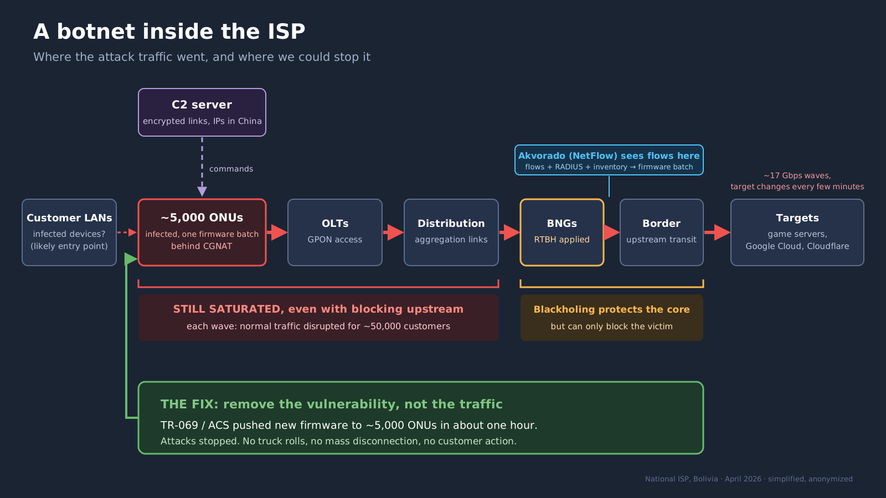
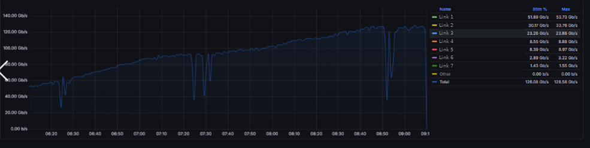
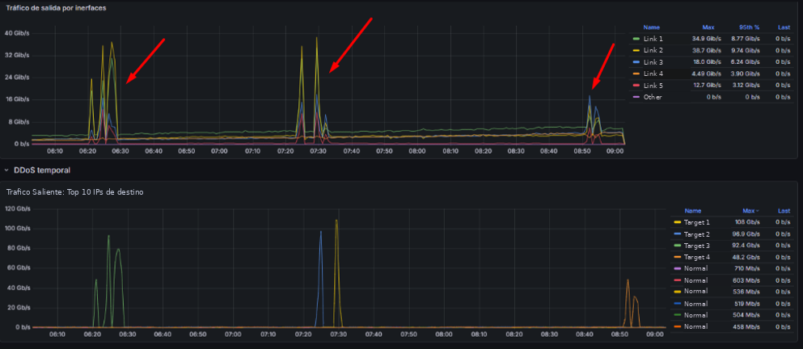

# 🛡️ Case Study: A Botnet Inside Our Own ISP

> How flow telemetry turned an "everything is saturated" incident into a targeted firmware fix, and why response time mattered more than any single tool.

**Role:** Access network engineer, national ISP (Bolivia)
**When:** April 2026, about three weeks
**Tools:** Akvorado · NetFlow/IPFIX · ClickHouse · Grafana · n8n · RADIUS · RTBH · TR-069 (ACS) · GPON access
**Outcome:** About 5,000 compromised ONUs identified and patched remotely in one hour; the attacks stopped

*All IP addresses, hostnames and customer data have been omitted or anonymized. This describes the network as it was during the incident, not its current configuration or defenses.*

---

## TL;DR

For three weeks, a botnet running on about **5,000 of our own customers' ONUs** launched DDoS waves from inside our network, reaching **~100 Gbps toward a single target**. Each wave disrupted normal traffic for around **50,000 subscribers**, most likely because the saturated upstream left no room for legitimate traffic. Using flow data from **Akvorado**, cross-referenced with RADIUS and our device inventory, we traced every attacking device to **one batch of ONUs running a specific firmware version**. Every blocking attempt was too slow, blocked the wrong side, or only paused the traffic. The fix was removing the vulnerability: once the vendor's firmware was available, we updated all affected ONUs through **TR-069 in about an hour**, and the attacks stopped.



---

## 1. The situation

At first it looked like ordinary upstream spikes. Interface graphs showed the links filling up and customers reported latency and packet loss, but we had no idea who was talking to whom.

We were still deploying **Akvorado** when it started. Flow export was running on only one router, so for the first days we were investigating with a partial view of the network. Bringing the rest of the routers into Akvorado, in the middle of the incident, took a few more days.

This was not a classic inbound DDoS. The traffic came **from inside our own access network**: customer equipment, controlled by a botnet, was attacking external targets.

As the waves grew, the impact stopped being partial. **During each attack, normal traffic for around 50,000 customers was affected.** Our working explanation is upstream saturation: with the upstream path full of attack traffic, normal packets (DNS queries, ACKs, everything) had no room to leave the network. Infected or not, everyone felt it.



*Total traffic on the network's main links during one morning of attacks. Here the attacks don't show up as spikes but as drops: every time the upstream saturated, total traffic collapsed (at 08:52, from about 125 Gbps to about 35 Gbps) and recovered only when the wave ended. Link names have been replaced.*

---

## 2. Watching the botnet escalate

Once we had flow visibility, we could watch the operators learn how far they could push our network.

The targets were **game servers** and hosts inside **Google Cloud and Cloudflare data centers**. Our network was the launch platform, not the victim.

Most of the incident was pure UDP. The pattern changed over three weeks:

| Phase | Frequency | Behavior |
|---|---|---|
| **Probing** | One attack, then a day or two of silence | Short bursts of about 5 minutes against a single IP |
| **Escalation** | About one attack every three days | Longer attacks, higher volume |
| **Pressure** | Two or three attacks a day, around 6 a.m. | Several destinations per attack; each wave disrupted service across the whole network |
| **Last day** | Consecutive attacks all morning | Waves of several minutes, one destination after another, for about 2 hours. TCP floods appeared alongside the UDP ones |

They started by testing volume and detection. By the end they were running multiple targets in sequence and had added TCP. The trend was clear: without a real fix, the network was heading toward being down more often than up.

The graphs told the same story at every layer of the network.


*On a single access OLT uplink, upstream (green) normally sits around 50 Mbps. At about 04:47 it jumps to ~700 Mbps for a few minutes, at the quietest hour of the night.*


*The same bursts on a 20 Gbps transit link. Cacti averages every 5 minutes, so a 16 Gbps average means sub-minute bursts at line rate that the graph flattens. Graphs like this showed that something was wrong; they couldn't show who or why.*


*Akvorado, seen from the only exporter we had at first: seven successive waves of ~17 Gbps, each aimed at a different destination, one right after another, while normal traffic on that router stayed around 5 Gbps. Destination IPs have been replaced with labels.*



*Later, with all routers exporting flows, the full size of the waves became visible. Top: outbound traffic per link, with peaks of up to ~39 Gbps on a single link. Bottom: outbound traffic by destination. Each wave sent up to ~108 Gbps toward a single target, while normal destinations stayed below 1 Gbps. Router names, interfaces and destination IPs have been replaced.*

The target switching matters: any defense that depends on knowing the destination IP falls behind every time the target changes.

---

## 3. Why this was hard

| Challenge | Why it mattered |
|---|---|
| **Highly distributed** | ~5,000 devices sending at once. No single source to block. |
| **Internal origin** | Traffic crossed our own access and distribution layers before we could filter it. |
| **Moving targets** | Destinations changed during the attack, so blocking one IP didn't end it. |
| **Changing protocols** | UDP first, TCP added at the end. Filters built for one didn't cover the other. |
| **Partial visibility** | Only one exporter was online when the attacks started. |
| **Network-wide impact** | 5,000 infected devices were enough to fill the upstream and disrupt service for ~50,000 customers. |
| **Customer impact of the cure** | Disconnecting thousands of paying subscribers was neither easy nor fast. |

---

## 4. Investigation

### Step 1: Find the targets
In Akvorado I filtered flows by destination during the attack windows. A small set of IPs received the bulk of the traffic.

### Step 2: Find the sources
Pivoting on those destinations showed thousands of source addresses, all inside our subscriber ranges, bursting in coordination. Classic botnet signature.

### Step 3: Turn IPs into devices
Subscriber IPs are dynamic, so an IP alone is useless. With the IT team we cross-referenced the source IPs and timestamps against RADIUS accounting and mapped each session to the CPE behind it.

### Step 4: Find the common factor
Once we had the devices and checked them against inventory, the pattern was obvious: every attacking subscriber was using an ONU from one specific batch, running one firmware version. About 5,000 devices. The rest of the fleet was clean.

```
Flow data (Akvorado)          RADIUS accounting          Device inventory / ACS
──────────────────────        ──────────────────         ──────────────────────
attack window            ─►   source IP + time      ─►   ONU model + firmware
destination IPs               → subscriber session        → common vulnerable version
thousands of source IPs
```

### Step 5: Look inside an infected device
We pulled one of the compromised ONUs and found encrypted connections to IP addresses in China, consistent with a C2 channel. The device was also actively scanning IP ranges and other equipment.

We never confirmed the initial infection vector. The ONUs had their security filters enabled and sat behind CGNAT, so they were not reachable from the internet. The only exposed side was the customer LAN. Our working hypothesis is that malware on a customer's own devices compromised one or a few ONUs over the LAN, and the infection then spread to other units running the same vulnerable firmware.

---

## 5. Why packet capture wasn't enough

We captured traffic during the attacks and analyzed one of the infected ONUs. The main PCAP was about 20 GB; a full deep dive wasn't practical in the middle of the incident (that analysis deserves its own post).

What we did see was useful but limited:

- Encrypted sessions to China (C2).
- The ONU scanning IP ranges and other devices.
- Clear identification of the destinations receiving the floods.

During the floods themselves, the packets were mostly repetitive payload. The interesting evidence lived outside the attack windows.

We also tried blocking the Chinese IPs we had observed. It had little lasting effect: those addresses could change, and the attack traffic itself came from our own ONUs, not from China. Blocking the C2 never stopped the flood.

In the end, flow metadata plus correlation with RADIUS and inventory answered "who" and "why." Packet capture confirmed the botnet and the scanning, but it didn't give us a practical way to stop it.

---

## 6. Mitigation: what we tried, and what each attempt taught us

While we waited for a firmware fix, we tried several ways to contain the attacks. Each one solved part of the problem and exposed the next.

### Attempt 1: Manual RTBH
We blackholed the attacked destinations.
**Problem:** it was manual and slow. With short waves and changing targets, the block often arrived after the damage was done.

### Attempt 2: Automated detection and blackholing
I built a pipeline to remove the human delay:

```
ClickHouse queries  ─►  Grafana alert  ─►  webhook to n8n  ─►  extract attacked IPs  ─►  add them to the RTBH blacklist
(Akvorado flow data)    (upstream anomaly)
```

**Problem:** response time improved, but we were still blocking the wrong side. Because the attackers were inside our network, we could only blackhole the destination, the victim. The botnet simply moved to the next target. And because the filter sat at the BNGs, the access and distribution layers stayed saturated.

### Attempt 3: Cutting service to the affected devices
The drastic option was to suspend the identified subscribers or apply ACLs.
**Problem:** we could identify the devices, but there was no mass-disconnection process ready at the time. Applying the cuts took far longer than a wave lasted.

### Attempt 4: Filtering UDP at the BNG
Early on, the traffic was almost pure UDP, so we tried dropping UDP from the affected subscribers at the BNG. The idea was that interrupting the flow would kill the attack.

**What happened:** while the filter was up, the attack stopped leaving the network. The moment we removed the filter to restore normal service, the attack came back immediately. The ONUs had never stopped generating traffic; the packets were just being dropped at the BNG. UDP is connectionless: it doesn't need a response or an established session to keep sending.

And even while the filter was up, the access and distribution networks stayed full the whole time. Filtering at the BNG only hid the problem from the upstream links. By the last day TCP floods had appeared as well, so a UDP-only filter would have been even less useful.

### Three weeks of watching
For most of the incident, the honest summary is this: we could see every wave in detail and we couldn't stop it. Visibility told us exactly what was happening; it didn't give us a fast enough way to act.

### The limits weren't only technical
Even with the devices identified, the obvious actions were off the table:

- Notifying 5,000 customers one by one wasn't feasible, and customer service was already overwhelmed.
- Mass service cuts were a serious decision that needed more than a technical green light.
- Replacing 5,000 ONUs in the field would have taken months.

An ISP is expected to be neutral, but staying passive meant letting a botnet inside our network disrupt service for everyone. Having the technical means is only half of the answer; the criteria for using them need to be agreed in advance.

### The fix: removing the vulnerability
The only action that needed neither customer involvement nor truck rolls was the root-cause fix:

1. We identified the affected ONU batch and firmware version.
2. As soon as the corrected firmware was available, the ACS team pushed it to all ~5,000 devices via TR-069 in about one hour.
3. We validated the result in Akvorado.

What would have taken months of field work took one hour. After the update, the attack traffic disappeared and the disruptions stopped.

---

## 7. Results

- ✅ Attack traffic disappeared after the firmware update
- ✅ ~5,000 compromised ONUs patched remotely in about one hour
- ✅ No more network-wide disruptions for the ~50,000 customers each wave had affected
- ✅ Root cause pinned to one vulnerable firmware batch, not the whole fleet
- ✅ Akvorado became a permanent part of incident response and security monitoring

---

## 8. Lessons learned

1. **In DDoS, response time is everything.** Every mitigation we tried worked on paper. What decided whether it worked in practice was how many minutes it took to apply. A block that arrives in 15 minutes doesn't help against a 5-minute wave.

2. **Seeing an attack is not the same as stopping it.** For three weeks we had excellent visibility and almost no way to act on it. Detection has to come with a mitigation path that is already built and tested.

3. **Where you can mitigate matters as much as how.** With an internal attack, blackholing or filtering at the BNG protects the core but leaves access and distribution saturated. The closer to the source, the better. In this case, the only action that was effective and fast enough was removing the vulnerability itself.

4. **Dropping traffic is not stopping it.** UDP doesn't need a response, so filtering it at the BNG only paused the exit while the sources kept sending. Once TCP appeared, a UDP-only filter was even less useful. And blocking the C2 didn't help either: the bots already running kept attacking.

5. **Policy and process matter as much as tools.** Even after we knew exactly which devices were compromised, the lack of an agreed, tested process for acting on them slowed us down. Visibility without an operational path is only half the solution.

6. **Interface graphs are not observability, and partial visibility is not enough.** Graphs tell you *that* something is wrong, never *what*. One exporter was enough to start the investigation, but completing the integration during the incident cost us days.

7. **Correlation beats volume.** Flows gave us IPs; flows + RADIUS gave us devices; devices + inventory gave us the root cause.

8. **DDoS is not always external, and outbound attacks can take down your own network.** A botnet inside the access network doesn't just harm its targets; by saturating upstream it can disrupt service for every customer.

9. **CPE firmware is a security control, and CGNAT is not a firewall for the LAN side.** Devices unreachable from the internet were still compromised from inside customer networks. A working TR-069/ACS platform is what turned the fix into a one-hour remote update.

---

## 9. What I'm working on next

This incident showed that detecting an attack once it starts is too late. My focus now is on **earlier detection**: spotting the first stages of an intrusion, such as scanning and abnormal device behavior, before they turn into an attack, and automating the response with open-source tools (flow data, Grafana, n8n, Malcolm).

I'll publish what I learn as generic, lab-based write-ups, starting with the analysis of that 20 GB capture.

---

*If you're running an ISP or access network and you're still relying mainly on interface graphs, this incident is a good reminder of what flow telemetry can, and cannot, do for you.*

## 📫 Contact

Open to remote roles in **Network Automation, Network Security or Observability**, and to consulting for mid-size ISPs on **NetFlow deployment and DDoS readiness**.

[LinkedIn]([https://linkedin.com/in/your-profile](https://www.linkedin.com/in/javier-mejia-59261416a/?isSelfProfile=true)) · mail: javier.mejia.bo@gmail.com
