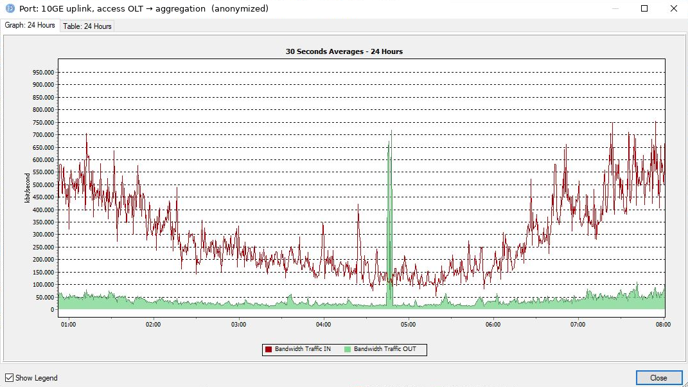
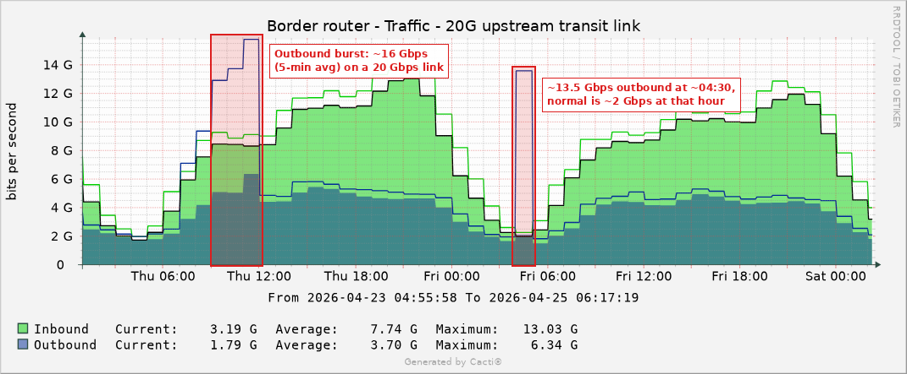
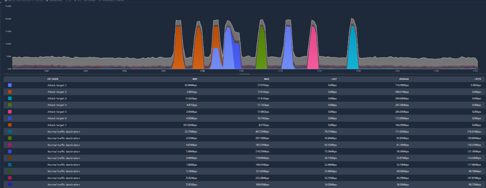
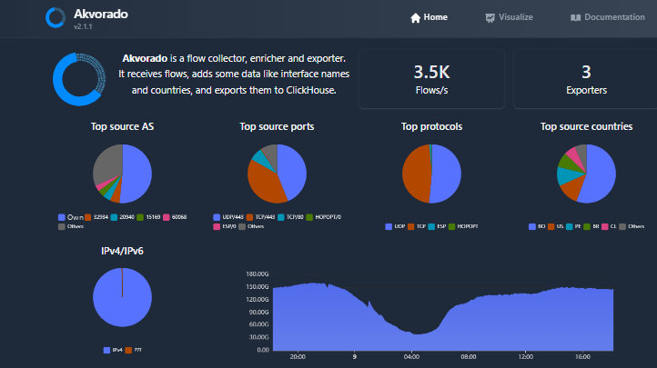

# 🛡️ Case Study: Detecting and Mitigating a Subscriber-Originated DDoS with Akvorado

> How flow telemetry turned an "everything is saturated" incident into a targeted firmware fix, and why response time turned out to matter more than any single tool.

**Role:** Access network engineer, national ISP (Bolivia)
**When:** April 2026, about three weeks
**Tools:** Akvorado · NetFlow/IPFIX · ClickHouse · Grafana · n8n · RADIUS · RTBH · TR-069 (ACS) · Juniper MX · Cisco BNG · GPON access
**Outcome:** About 5,000 compromised ONUs identified and patched remotely in one hour; network-wide outages ended

*All IP addresses, hostnames and customer data have been omitted or anonymized.*

---

## TL;DR

For three weeks, a botnet running on about **5,000 of our own customers' ONUs** launched DDoS waves from inside our network. The attacks saturated our upstream links, and each wave cut service for around **50,000 subscribers**, dropping about **180 Gbps** of legitimate traffic. Using flow data from **Akvorado**, cross-referenced with RADIUS and our device inventory, we traced every attacking device to **one batch of ONUs running a specific firmware version**. Our blocking attempts were too slow or blocked the wrong side, so the fix was removing the vulnerability: once the vendor's firmware was available, we updated all affected ONUs through **TR-069 in about an hour**, and the attacks stopped.

---

## 1. The situation

We were still deploying **Akvorado** as our NetFlow/IPFIX collector when the network started suffering sudden, massive traffic bursts.

The deployment was only partial at that point. Flow export was running on the **Juniper MX104**, but the **Cisco BNGs** were not integrated yet, so we were investigating with a view of only part of the network. It took us a few more days, in the middle of the incident, to bring all three BNGs into Akvorado and get the full picture.

This was not a classic inbound DDoS against our network. The traffic came **from inside our own access network**: customer equipment, controlled by a botnet, was attacking external targets.

The first symptoms were:

- Unexpected spikes in **upstream** traffic
- Saturation events on core links
- Customer reports of latency and packet loss
- Traffic patterns that didn't match normal subscriber behavior

As the attacks grew, the impact stopped being partial. **During each wave, around 50,000 customers lost service** and about **180 Gbps of legitimate traffic** was dropped. The upstream channel was saturated by attack traffic, and with no capacity left in that direction, normal traffic couldn't get through either: requests, acknowledgments and DNS queries never left the network, so browsing, streaming and everything else stopped for everyone, infected or not.

Until then, our main monitoring was **interface graphs**. They showed the impact (full links) but nothing about the traffic itself: no sources, no destinations, no pattern.

---

## 2. Watching the botnet escalate

Flow visibility didn't just show the attack; it let us watch the botnet's behavior change over time.

**The targets.** The destination IPs belonged to **game servers** and to hosts inside **Google Cloud and Cloudflare data centers**. Our network was being used as a launch platform, not as the victim.

**The pattern.** At first it looked like the operators were **testing**: how much traffic could they generate from our network, and would anything limit them?

Over the three weeks, both the attacks and the outages escalated:

| Phase | Frequency | Behavior |
|---|---|---|
| **Probing** | One attack, then a day or two of silence | Short bursts of about 5 minutes against a single IP |
| **Escalation** | About one attack every three days | Longer attacks, higher volume |
| **Pressure** | Two or three attacks a day, around 6 a.m. | Several destinations per attack, each wave cutting service for the whole network |
| **Last day** | Consecutive attacks all morning | Waves of several minutes, one destination after another, for about 2 hours |

The fix arrived just in time. The trend was clearly heading toward a network that would be down more often than up.



*Early probing phase, seen on a single access OLT uplink. Upstream (green) normally sits around 50 Mbps; at about 04:47 it jumps to ~700 Mbps for a few minutes, at the quietest hour of the night.*



*The same pattern on a 20 Gbps upstream transit link. Cacti averages every 5 minutes, so a 16 Gbps average means sub-minute bursts at line rate that the graph flattens. Graphs like this showed something was wrong; they couldn't show who or why.*



*Akvorado during the last attack: subscriber traffic by destination over one hour, seen from the MX104, the only exporter at the time. Seven waves of about 17 Gbps, each lasting a few minutes and each aimed at a different destination, one right after another. Under the waves, normal traffic on this router stays around 5 Gbps. Destination IPs have been replaced with labels.*

The target switching matters: any defense that depends on knowing the destination IP falls behind every time the target changes.

---

## 3. Why this was hard

| Challenge | Why it mattered |
|---|---|
| **Highly distributed** | About 5,000 devices sending traffic at once. No single source to block. |
| **Internal origin** | The attack started in our access network, so the traffic crossed our own access and distribution links before reaching any point where we could filter it. |
| **Moving targets** | Destinations changed during the attack, so blocking one IP didn't end it. |
| **Partial visibility** | Only one exporter was sending flows when the attacks started. |
| **Network-wide outage** | 5,000 infected devices were enough to fill the upstream channel and cut service for around 50,000 customers. |
| **Customer impact of the cure** | Disconnecting thousands of paying subscribers was not an easy decision, and not a fast one. |

---

## 4. Investigation

### Step 1: Find the targets
In Akvorado, I filtered flows by destination during the attack windows. A small set of destination IPs received the bulk of the traffic.

### Step 2: Find the sources
Pivoting on those destinations, I extracted every **source IP** sending traffic to them. The result: thousands of addresses, all inside our subscriber ranges, bursting in coordination. A clear botnet signature.

### Step 3: Turn IPs into devices
Subscriber IPs are dynamic, so an IP alone doesn't identify a device. Together with the IT department, we **cross-referenced source IPs and timestamps with RADIUS accounting** to map each address to a subscriber session and the CPE behind it.

### Step 4: Find the common factor
With the devices identified and checked against our inventory, the pattern was clear: the affected subscribers had **ONUs from one batch running a specific firmware version**. About 5,000 devices; the rest of the fleet was not involved.

```
Flow data (Akvorado)          RADIUS accounting          Device inventory / ACS
──────────────────────        ──────────────────         ──────────────────────
attack window            ─►   source IP + time      ─►   ONU model + firmware
destination IPs               → subscriber session        → common vulnerable version
thousands of source IPs
```

### Step 5: Look inside an infected device
We analyzed one of the compromised ONUs and found **encrypted connections to IP addresses in China**, consistent with a command-and-control channel.

We could not confirm how the devices were infected. The ONUs had their security filters enabled and sat **behind CGNAT**, so they were not reachable from the internet. The only exposed side was the **customer LAN**. Our working hypothesis: malware on a customer's own devices compromised one or a few ONUs through the LAN, and the infection spread from there to other units running the same vulnerable firmware.

---

## 5. Why packet capture wasn't enough

We also captured traffic during the attacks. It revealed very little: in a flood, packets are mostly repetitive payload with nothing that points to the C2, the infection vector or the vulnerable device.

The useful evidence (DNS lookups, beacons to the C2, the initial exploit) lives **before or outside** the attack window, which is exactly what the analysis of the infected ONU showed. During the flood itself, **flow metadata plus correlation** was what actually answered *who* and *why*.

---

## 6. Mitigation: what we tried, and what each attempt taught us

While we waited for a firmware fix, we tried several ways to contain the attacks. Each one solved part of the problem and exposed the next.

### Attempt 1: Manual RTBH
We enabled **Remotely Triggered Black Hole** routing to drop traffic toward the attacked destinations.

**Problem:** it was manual. Between detecting the attack and blackholing the IP, too much time passed, and it depended on having someone available to run the block. With short waves and changing targets, the block often arrived after the damage was done.

### Attempt 2: Automated detection and blackholing
I built an automated pipeline to remove the human delay:

```
ClickHouse queries  ─►  Grafana alert  ─►  webhook to n8n  ─►  extract attacked IPs  ─►  script adds them to the RTBH blacklist
(Akvorado flow data)    (upstream anomaly)
```

**Problem:** response time dropped, but two limits remained.

- **It blocked the wrong side.** Because the attackers were inside our own network, the only thing we could blackhole was the **destination**, the victim, not the sources. Blocking the victim doesn't stop the flood; the botnet simply moved to the next target.
- **The internal links stayed saturated.** The block was applied at the **BNGs**, the head end of the network. By then the traffic had already crossed the access and distribution layers. We protected the core and the upstream links, but everything below the BNG was still full.

### Attempt 3: Cutting service to the affected devices
The drastic option was to stop the traffic at its source: apply ACLs or suspend service for the identified subscribers.

**Problem:** time again. We could identify the devices, but we had no mass-disconnection process built. Applying ACLs or service cuts across that many subscribers would take **10 to 20 minutes**, while the attack kept running.

### Three weeks of watching
For most of the incident, the honest summary is this: we could see every wave on screen, in detail, and we couldn't stop it. Visibility told us exactly what was happening; it didn't give us a fast enough way to act on it.

### The limits weren't only technical
Even with the affected devices identified, the obvious actions were off the table:

- **Notifying 5,000 customers** one by one wasn't feasible, and customer service was already under heavy pressure from the outages.
- **Mass service cuts or notifications** ran into customer policies that didn't allow them.
- **Replacing 5,000 ONUs** in the field would have taken months.

This raised a question that every ISP eventually faces: how far should a provider go in acting on its customers' traffic? An ISP is expected to be neutral, but staying passive meant letting a botnet inside our network take down service for everyone. A technical solution existed; the policy framework to use it quickly did not.

### The fix: removing the vulnerability
The decisive action was the root-cause fix, the one option that needed neither customer action nor truck rolls:

1. **Identified** the affected ONU batch and firmware version.
2. As soon as the corrected firmware was available, our ACS administrator **pushed it to all ~5,000 affected ONUs through TR-069 in about one hour**.
3. **Validated** the result in Akvorado dashboards.

What would have taken months of field work took one hour. No truck rolls, no mass disconnection, no customer action needed.

---

## 7. Results

- ✅ Attack traffic **disappeared** after the firmware update
- ✅ ~5,000 compromised ONUs patched remotely in **about one hour**
- ✅ No more network-wide outages for the ~50,000 customers that each wave had knocked offline
- ✅ Root cause pinned to **one vulnerable firmware batch**, not the whole fleet
- ✅ Akvorado became a permanent part of incident response and security monitoring, now covering all three BNGs and the full subscriber traffic (about 3,500 flows/s, ~150 Gbps at peak)



*Akvorado today, with the three BNGs exporting flows. The internal AS number has been replaced with "Own".*

---

## 8. Lessons learned

1. **In DDoS, response time is everything.** Every mitigation we tried worked on paper. What decided whether it worked in practice was how many minutes it took to apply. A block that arrives in 15 minutes doesn't help against a 5-minute wave.
2. **Seeing an attack is not the same as stopping it.** For three weeks we had excellent visibility and almost no way to act on it. Detection has to come with a mitigation path that is already built and tested.
3. **Where you can mitigate matters as much as how.** With an internal attack, blackholing protects the core but blocks the victim and leaves access and distribution saturated. The closer to the source, the better.
4. **Prepare the drastic options before you need them, technically and in policy.** Mass ACLs or service suspension for a list of subscribers should be a tested, one-step procedure, and the rules for when an ISP may use it should be agreed before the incident, not debated during it.
5. **Interface graphs are not observability, and partial visibility is not enough.** Graphs tell you *that* something is wrong, never *what*. One exporter was enough to start the investigation, but finishing the Cisco integration during the incident cost us days.
6. **Correlation beats volume.** Flows gave IPs; flows + RADIUS gave devices; devices + inventory gave the root cause.
7. **DDoS is not always external, and outbound attacks can take down your own network.** A botnet inside the access network doesn't just harm its targets; by saturating upstream it can cut service for every customer.
8. **CPE firmware is a security control, and CGNAT is not a firewall for the LAN side.** Devices unreachable from the internet were still compromised from inside customer networks. A working TR-069/ACS platform is what turned the fix into a one-hour remote update.

---

## 9. What I'm building next

This incident showed that detecting an attack once it starts is too late. The next step is catching the earlier stages, so I'm building a small **SOC for the ISP** from the same pieces:

- **RTBH for scanners first:** automatically blackhole IPs that scan the network, before they get to the exploitation stage
- **Honeypot** to detect sources in the early phases of an intrusion
- **Recursive DNS abuse:** after this event we also found that abuse of recursive DNS is common and generates a steady flow of malicious traffic; its detection and blocking is being automated
- **Threat detection pipeline** joining Grafana, n8n, Malcolm, OPNsense and Proxmox, for detection and automatic extraction of attack data

---

## 📫 Contact

Open to remote roles in **Network Automation, Network Security or Observability**, and to consulting for mid-size ISPs on **NetFlow deployment and DDoS readiness**.

www.linkedin.com/in/javier-mejia-59261416a
